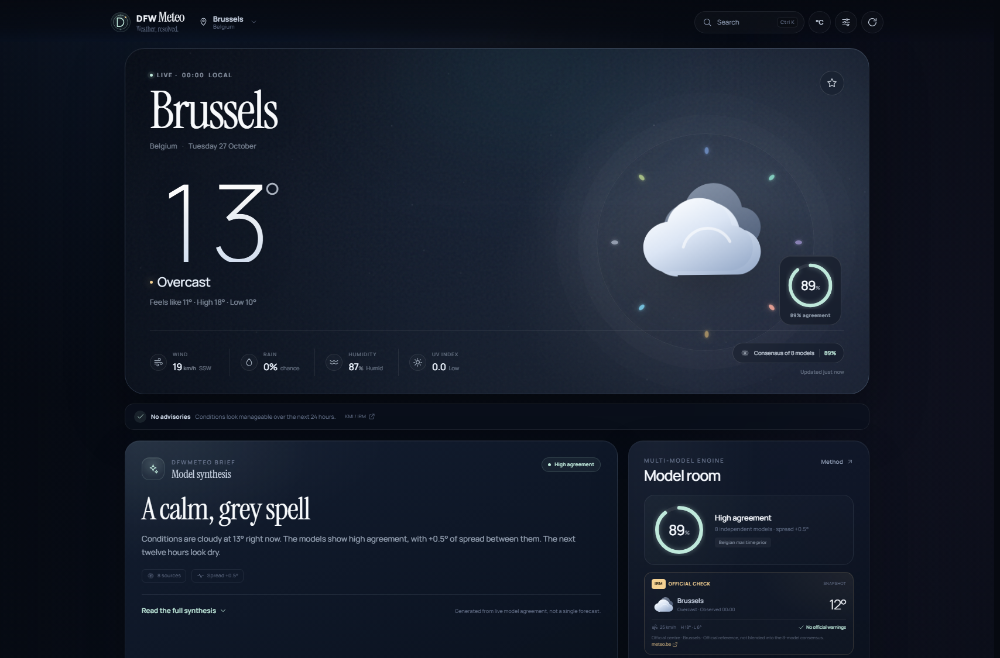
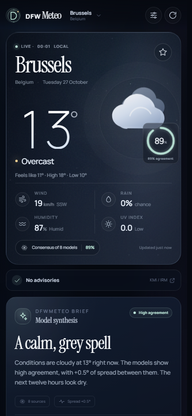
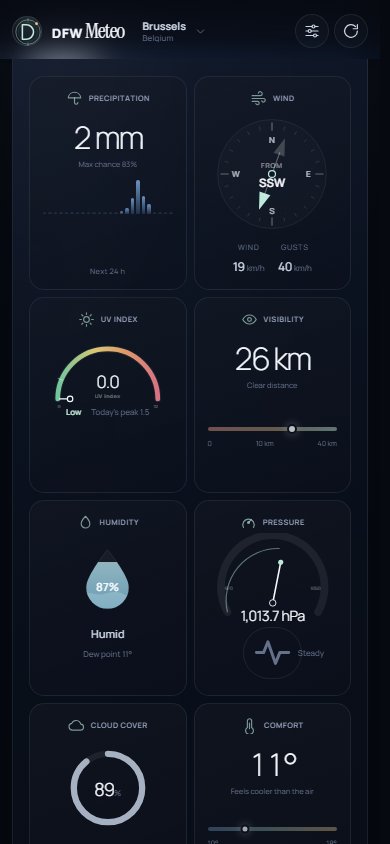

# DFWMeteo

**Eight skies. One forecast.**

DFWMeteo is a premium, independent weather app that resolves eight numerical weather
models into one calm, explainable forecast. It is tuned for Belgium first and
works for any location through Open-Meteo's global model set.



## What it does

- **Multi-source consensus** — ECMWF IFS, DWD ICON, UK Met Office, Météo-France,
  NOAA GFS, ECCC GEM, JMA and CMA GRAPES are fetched in parallel for the same
  coordinates and time zone.
- **Belgium-first weighting** — regional priors favour high-resolution European
  models around the North Sea, then adapt by country and continent.
- **Official Belgian layer** — for Belgian locations, an IRM/KMI observation and
  forecast is shown as a distinct official check. It is deliberately not blended
  into the numerical-model consensus.
- **Transparent confidence** — weighted temperature consensus, circular wind
  means, weighted weather-code voting, model spread and agreement scores are
  exposed rather than hidden behind a single number.
- **A complete forecast surface** — current conditions, an editorial brief,
  24-hour timeline, interactive eight-model spread chart, 10-day outlook with
  source-by-source daily detail, high-resolution two-hour nowcast, air quality,
  pollen, sun, moon, UV, visibility, humidity, pressure and smart advisories.
- **Belgian and global places** — curated Belgian cities, browser geolocation,
  saved places, shareable URLs and worldwide search.
- **Trilingual** — English, French and Dutch interfaces with localized dates,
  numbers, weather descriptions and briefings.
- **Premium dark interface** — an aurora/observatory aesthetic, custom SVG
  weather glyphs, animated atmosphere, responsive layouts, centred mobile detail
  tiles and reduced-motion mode.
- **Built to stay useful** — automatic refresh, manual forced refresh, in-memory
  caching, local fallback cache, offline banners, keyboard navigation and clear
  error recovery.

<p align="center">
  
  
</p>

## Run it locally

Requires **Node.js 22.18+** (Node 26 recommended). Local mode needs no API key.

```bash
npm install
npm run dev
```

Open <http://127.0.0.1:5173>. The local Express server fetches the eight models,
serves the app, and queries IRM/KMI live for Belgian locations.

For a production-like local run:

```bash
npm start
```

The app uses `PORT` if set. The server binds to `127.0.0.1`.

## Deploy to GitHub Pages

GitHub Pages is static, so DFWMeteo ships a browser build of its consensus engine.
It calls Open-Meteo, Open-Meteo geocoding and BigDataCloud directly, and loads a
build-time IRM/KMI snapshot for twelve Belgian centres.

1. Push this directory to a GitHub repository.
2. In the repository, open **Settings → Pages → Build and deployment**.
3. Set **Source** to **GitHub Actions**.
4. Push to `main` (or run **Deploy DFWMeteo to GitHub Pages** manually from Actions).

The workflow at [`.github/workflows/pages.yml`](.github/workflows/pages.yml)
runs the typecheck, builds `dist/`, fetches the IRM snapshot, and deploys the
artifact. It also runs every 30 minutes to refresh the official Belgian layer.
The site will be available at `https://<username>.github.io/<repository>/`;
all asset paths are relative, so project-site subpaths work.

No API keys or secrets are required. The static app keeps the same UI, search,
favourites, unit/language preferences, local cache and model comparison. The
IRM official layer only requires an internet connection at build/deploy time,
which avoids the browser CORS restrictions on the IRM app endpoint.

To preview the exact static artifact locally:

```bash
npm run preview
```

This builds `dist/` and serves it at <http://127.0.0.1:4173>.

## Tests & checks

```bash
npm test          # consensus math, weather-code voting, confidence
npm run typecheck # TypeScript server/IRM check
npm run test:api  # live Brussels aggregation smoke test
npm run build     # typecheck + static GitHub Pages build
node scripts/check-i18n.mjs
```

The browser app is dependency-free at runtime. The only runtime dependencies of
the local server are Express and compression; esbuild is used only to produce the
static GitHub Pages engine. Fonts are bundled locally, so the interface does not
depend on Google Fonts or a CDN.

## How the forecast is built

1. **Gather** — one parallel Open-Meteo request returns hourly and daily fields
   for all eight models; air quality and the 15-minute nowcast are fetched
   separately.
2. **Weight** — regional priors give ECMWF, ICON, UKMO and Météo-France more
   influence in Belgium than global-only systems. North America leans toward
   GFS and GEM; Asia toward JMA and CMA. Weights are normalised across the
   sources that actually returned data.
3. **Resolve** — temperatures use a trimmed weighted mean; wind direction uses a
   circular mean; weather codes use weighted group voting. The confidence score
   measures how tightly the sources cluster. It is an agreement signal, not a
   guarantee of accuracy.
4. **Explain** — every source's current value, deviation from consensus,
   influence and 24-hour mean deviation are visible in the interface. The
   methodology dialog explains the limits.

### The IRM/KMI layer

The IRM/KMI layer is intentionally separate from the eight-model blend. It is an
official Belgian observation/forecast reference, so mixing it into a numerical
model consensus would blur two different kinds of evidence. It appears in the
Model room with its observation time, wind, high/low, distance to the nearest
official centre and any official warnings.

- **Local server mode:** queried live for the exact coordinate.
- **GitHub Pages mode:** generated at build/deploy time for the nearest of
  twelve Belgian centres, then refreshed by the scheduled workflow. The UI
  labels it `Snapshot` and shows the centre/distance.

The endpoint used is the IRM/KMI mobile-app endpoint, which is not publicly
documented and can change without notice. This integration is best-effort and
is not affiliated with or endorsed by IRM/KMI.

## Data & attribution

Forecasts and air quality are provided by [Open-Meteo](https://open-meteo.com/)
and its upstream model centres: ECMWF, DWD, the UK Met Office, Météo-France,
NOAA, ECCC, JMA and CMA.

Model data is © Open-Meteo contributors, licensed under
[CC BY 4.0](https://creativecommons.org/licenses/by/4.0/). DFWMeteo's interface,
weighting, IRM parser and synthesis are independent.

DFWMeteo is **not** an official warning service. For official Belgian alerts, consult
[KMI/IRM](https://www.meteo.be/).

## Architecture

- `server/` — Express API, upstream fetch/caching, multi-model parsing, consensus
  engine and the live IRM/KMI official layer.
- `src-static/static-api.ts` — tiny browser entry that bundles the same consensus
  engine for GitHub Pages.
- `public/` — dependency-free browser app, custom SVG charts and visual system.
- `shared/` — shared TypeScript types and WMO weather-code mapping.
- `scripts/` — static build, IRM snapshot generation, consensus tests, live API
  smoke test and translation coverage check.
- `.github/workflows/pages.yml` — GitHub Pages build/deploy schedule.
- `docs/` — preview images.

No client framework is used. The interface renders from small data-driven
template functions, keeping the shipping client small and auditable.
