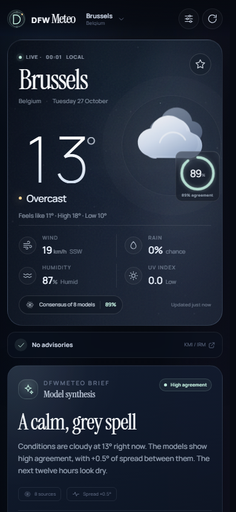
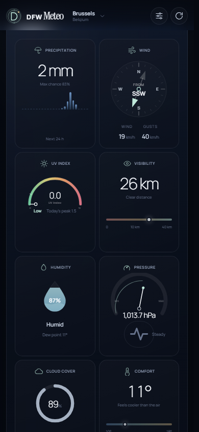

# DFWMeteo

**Twelve skies. One forecast.**

DFWMeteo is a premium, independent weather app that resolves twelve numerical weather
models into one calm, explainable forecast. It is calibrated for Belgium first and
works for any location worldwide through Open-Meteo's open model infrastructure.


## What it does

- **Multi-source consensus** — ECMWF IFS, DWD ICON, UK Met Office, Météo-France,
  KNMI Harmonie, MET Norway, DMI, BOM ACCESS-G, NOAA GFS, ECCC GEM, JMA and CMA GRAPES
  are fetched in parallel for the same coordinates and time zone.
- **Belgium-first weighting** — regional priors favour ultra-high-resolution European
  models (KNMI 2.5 km, AROME 1.3 km, ICON 2 km) around the North Sea, then adapt by country and continent.
- **Official Belgian layer (IRM / KMI)** — for Belgian locations, an IRM observation and
  forecast is shown as a distinct official check with regional snapshot fallback.
- **Transparent confidence** — weighted temperature consensus, circular wind
  means, weighted weather-code voting, model spread and agreement scores are
  exposed rather than hidden behind a single number.
- **Complete forecast surface** — current conditions, editorial brief,
  24-hour timeline, interactive twelve-model spread chart, 10-day outlook with
  source-by-source daily detail, 15-minute high-resolution nowcast, air quality,
  pollen, sun, moon, UV, visibility, humidity, pressure and smart advisories.
- **Installable PWA** — Service worker offline caching, manifest, dark observatory UI.
- **Trilingual** — English, French and Dutch interfaces with localized dates,
  numbers, weather descriptions and briefings.
- **Zero build step** — Pure native JavaScript (ES modules), HTML5, and CSS3. Runs directly in any modern browser without any compilation, bundler, or server.

<p align="center">
  
  
</p>

## Run it locally

No dependencies or installation required! Simply serve the directory with any static HTTP server:

```bash
# Using Python
python -m http.server 5173

# Or using npx
npx serve .

# Or using VS Code Live Server extension
```

Then open <http://localhost:5173> in your browser.

## Deploy to GitHub Pages

The repository is structured to deploy directly to GitHub Pages with zero build steps:

1. Push this repository to GitHub (`main` or `master`).
2. Under **Settings → Pages → Build and deployment**, set **Source** to **GitHub Actions**.
3. Push or trigger the workflow at `.github/workflows/pages.yml`. It deploys the root static directory instantly.

## The 12 Consensus Models

| Model | Center | Resolution / Region | Focus |
| :--- | :--- | :--- | :--- |
| **KNMI Harmonie** | KNMI (Netherlands) | 2.5 km Benelux | Local convective and North Sea boundary |
| **ECMWF IFS** | ECMWF | 0.25° Global | Flagship European global model |
| **ICON** | DWD (Germany) | 2–11 km Europe & Global | High-resolution continental core |
| **UK Met Office** | UKMO (United Kingdom) | 2–10 km | Atlantic frontal dynamics |
| **Météo-France** | Météo-France | 1.3–25 km | High-resolution AROME / ARPEGE |
| **MET Norway** | MET Norway | 1–2.5 km Europe | Nordic and coastal precipitation |
| **DMI** | DMI (Denmark) | 2.5 km Europe | Maritime North Sea / Baltic |
| **BOM ACCESS-G** | BOM (Australia) | 12 km Global | Southern hemisphere / global synthesis |
| **NOAA GFS** | NOAA (United States) | 3–13 km | Global prediction & American core |
| **ECCC GEM** | ECCC (Canada) | 2.5–10 km | High-latitude boreal dynamics |
| **JMA GSM** | JMA (Japan) | 5–20 km | Asian and Pacific spectral model |
| **CMA GRAPES** | CMA (China) | 0.25° Global | Global prediction system |

## Structure

```
DFWMeteo/
├── index.html            # Main entry point at root
├── styles.css            # Stylesheet
├── sw.js                 # PWA Service Worker (offline shell cache)
├── manifest.webmanifest  # PWA web manifest
├── favicon.svg           # Weather icon / favicon
├── fonts/                # Bundled local fonts (Manrope, Instrument Serif)
├── data/
│   └── irm.json          # 34-city IRM Belgian regional snapshot
├── js/
│   ├── app.js            # UI logic, state, and event bindings
│   ├── api.js            # API coordinator
│   ├── weather.js        # Multi-model consensus fetcher & aggregator
│   ├── consensus.js      # Consensus math (circular wind mean, weighted modes)
│   ├── models.js         # 12 numerical models & regional weight profiles
│   ├── geocode.js        # Location search & reverse geocoding
│   ├── precip-grid.js    # 10x10 rain zone radar grid
│   ├── precip-map.js     # Rain map UI widget & controls
│   ├── irm.js            # Belgian IRM parser & gateway
│   ├── charts.js         # SVG model spread & timeline charts
│   ├── format.js         # Weather formatting & conversions
│   ├── i18n.js           # Multi-language translations (FR, NL, EN)
│   ├── icons.js          # SVG weather glyphs
│   └── wmo.js            # WMO weather code definitions
├── docs/                 # Documentation screenshots
└── .github/workflows/    # Instant GitHub Pages deployment
```

## Data & attribution

Forecasts and air quality are provided by [Open-Meteo](https://open-meteo.com/)
and its upstream model centres. Model data is © Open-Meteo contributors, licensed under
[CC BY 4.0](https://creativecommons.org/licenses/by/4.0/). DFWMeteo's interface,
weighting, IRM parser and synthesis are independent.

DFWMeteo is **not** an official warning service. For official Belgian alerts, consult
[KMI/IRM](https://www.meteo.be/).
